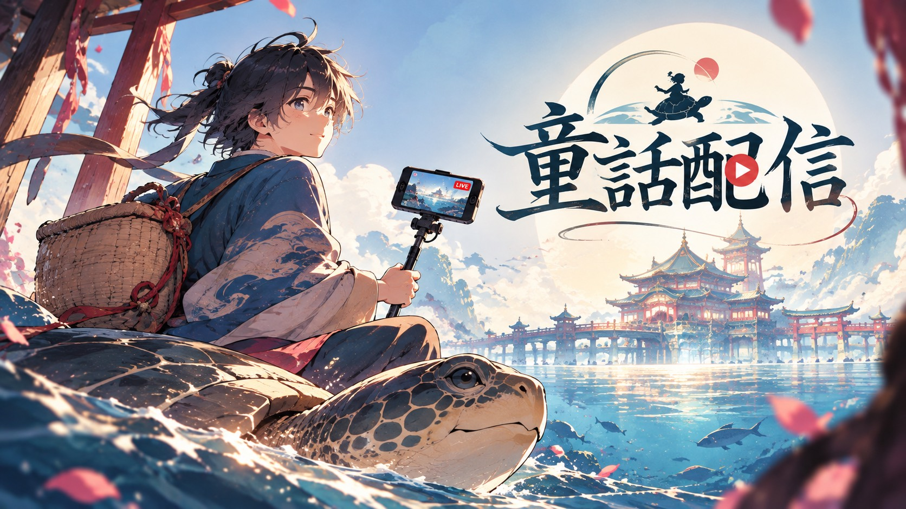

# 童話配信

## 製品概要
### 背景(製品開発のきっかけ、課題等）
昔話や童話は、誰もが知っている物語です。でも、読み聞かせでも絵本でも、聞き手は決まった結末を受け取るだけでした。「もし浦島太郎が亀を助けなかったら？」「玉手箱を開けなかったら？」。子どもの頃に一度は考えたこの「もしも」を、実際に自分で選んで確かめる方法はありません。

また、VR体験はヘッドセットをかぶった1人だけのものになりがちです。周りの人は、体験者が何を見て何に驚いているのか分からず、待っているだけになってしまいます。

### 製品説明（具体的な製品の説明）
「童話配信」は、絵本の中に入り込んで浦島太郎を演じる Meta Quest 向けのVRゲームです。体験の様子はスマホにそのまま配信され、視聴者も物語の分岐に参加できます。

部屋で絵本を開くと、光に包まれて物語の世界へ吸い込まれます。浜辺、海の中、竜宮城、故郷の村と進みながら、5つの分岐点で浦島太郎の行動を自分の体で選びます。ボタンを押して選ぶのではありません。子どもたちを手で追い払う、首を横に振って断る、料理を手に取って口に運ぶ、玉手箱のふたを持ち上げる。現実と同じしぐさがそのまま選択になります。選び方しだいで、物語は9つの結末に分かれます。

周りの人は、タイトル画面に出るURLをスマホで開くだけで、体験者のVR視点の映像、ナレーションの字幕、いまの選択肢をリアルタイムに見られます。コメントは弾幕としてVR空間にも流れます。選択肢には投票でき、体験者が迷って時間切れになると、視聴者の投票1位で物語が進みます。

### 特長
#### 1. 体の動きがそのまま物語の選択になる
選択肢は、物語の中で浦島太郎が実際にとる行動として用意しています。木の棒で亀を叩く、乙姫の手を取る、宴会場の奥の通路へ進むなど、手・頭・移動で選びます。VRならではの「自分が物語を動かしている」感覚を大事にしました。

#### 2. 誰もが知る昔話から、誰も知らない9つの結末へ
亀を見過ごすと「始まらない物語」（コメディ）。一緒にいたずらすると「亀の逆襲」（ホラー）。竜宮城の禁じられた部屋に入る、玉手箱をおじさんに託すなど、よく知った話が少しずつ別の物語へ変わっていきます。到達したエンディングは記録され、全部の結末を集める楽しみもあります。

#### 3. 見ている人も物語に参加できる
アプリのインストールやログインは不要です。スマホのブラウザでURLを開くだけで、VR視点の映像・字幕・選択肢を見ながら、投票・コメント・リアクションを送れます。体験者が迷っている間に視聴者が背中を押す、という1人用VRにはなかった遊び方ができます。

### 解決出来ること
* 決まった結末を受け取るだけだった昔話を、自分で選んで結末を確かめる体験に変えられます。
* VR体験中に周りの人が置いてけぼりになる問題を、配信と投票で「みんなで遊ぶ時間」に変えられます。
* ボタン操作に慣れていない子どもや大人でも、ふだんのしぐさだけで遊べます。

### 今後の展望
* 桃太郎、かぐや姫、赤ずきんなど、ほかの昔話・童話の絵本を増やす。
* 視聴者の投票で、物語の途中の出来事（天気、登場人物のセリフなど）も変えられるようにする。
* 学校や図書館での読み聞かせイベントで、1人が体験して、クラス全員が投票で参加する使い方を広げる。
* ナレーションと字幕の多言語化。

### 注力したこと（こだわり等）
* **絵本に入り、絵本から戻る演出**：絵本が光って吸い込まれる始まり方と、物語が光にほどけて部屋の絵本へ戻る終わり方を、対になるように作りました。暗転・白転は場面転換の酔い対策も兼ねています。
* **選択を体の動きで判定する仕組み**：叩く（手や棒の速さ）、首を振る（往復の回数）、口へ運ぶ、立ち去る、ふたを開けるなど、行動ごとに検出器を作りました。どの選択肢も物語の中の自然な行動になるよう設計しています。
* **回線が遅くても遅れが溜まらない配信**：送る内容を1本のリクエストにまとめ、受信はストリーミングで受けます。VR視点の画像は低解像度で撮り、JPEGへの変換を別スレッドで行うので、Questの描画が引っかかりません。
* **酔いにくい配信カメラ**：体験者の頭を少し遅れて追いかけ、傾きや細かな揺れを抑えたカメラで、視聴者も見やすい映像にしました。
* **全ルートの自動テスト**：9つのエンディングすべてに到達できることを、PlayModeテストで確認しています。

## 開発技術
### 活用した技術
#### API・データ
* Firebase Realtime Database（REST・ストリーミングでVRと視聴ページをつなぐ）
* Firebase Hosting（視聴ページの公開）
* VOICEVOX（ナレーション・登場人物の音声合成。栗田まろん、ずんだもん、春日部つむぎ、四国めたん、小夜/SAYO、ちび式じい）

#### フレームワーク・ライブラリ・モジュール
* Unity 6（6000.3）／ Universal Render Pipeline
* OpenXR ／ Meta XR SDK ／ Unity Input System
* TextMeshPro（日本語フォント：Noto Sans JP）
* Unity Test Framework（全エンディングの自動テスト）
* Blender 4.3（Python スクリプトによる船・魚・流木などのモデル生成）
* 視聴ページ：HTML / CSS / JavaScript（ES Modules）、Firebase JS SDK

#### デバイス
* Meta Quest
* スマートフォン・PC（ブラウザで視聴・投票）

### 独自技術
#### ハッカソンで開発した独自機能・技術
* **体の動きで選ぶ分岐システム**：選択肢ごとに「行動の検出器」を割り当て、成立した行動で物語が分岐します。VRの選択ボタンや視聴者の投票とも同じ仕組みで扱います。
  * [Assets/_Project/Scripts/Story/StoryDirector.cs](Assets/_Project/Scripts/Story/StoryDirector.cs)、[Assets/_Project/Scripts/Story/BranchTrigger.cs](Assets/_Project/Scripts/Story/BranchTrigger.cs)、[Assets/_Project/Scripts/Interaction/](Assets/_Project/Scripts/Interaction/)
  * commit: `358d4fe`（メインストーリー機能の作成）
* **VRと視聴ページをつなぐリアルタイム配信**：場面・字幕・選択肢・VR視点の画像を送り、投票・コメント・視聴者数を受け取ります。時間切れのときは投票1位で物語が進みます。
  * [Assets/_Project/Scripts/Streaming/LiveStream.cs](Assets/_Project/Scripts/Streaming/LiveStream.cs)、[Assets/_Project/Scripts/Streaming/SpectatorCamera.cs](Assets/_Project/Scripts/Streaming/SpectatorCamera.cs)、[Web/public/app.js](Web/public/app.js)
  * commit: `974717f`（配信機能の追加）
* **9つのエンディングの演出**：ホラー・コメディ・感動など、結末ごとに演出を作りました。
  * [Assets/_Project/Scripts/Endings/EndingDirector.cs](Assets/_Project/Scripts/Endings/EndingDirector.cs)
* **選択肢の途中から始める機能・チャプター選択**：commit `f34f87a`
* **全ルートの自動テスト**：[Assets/_Project/Scripts/Tests/AllRoutesTest.cs](Assets/_Project/Scripts/Tests/AllRoutesTest.cs)
